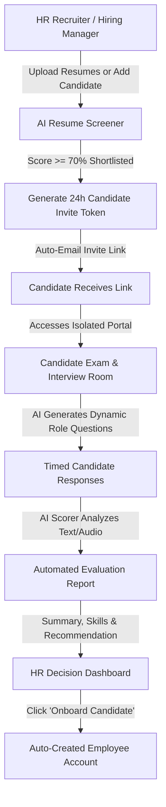
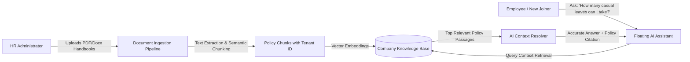
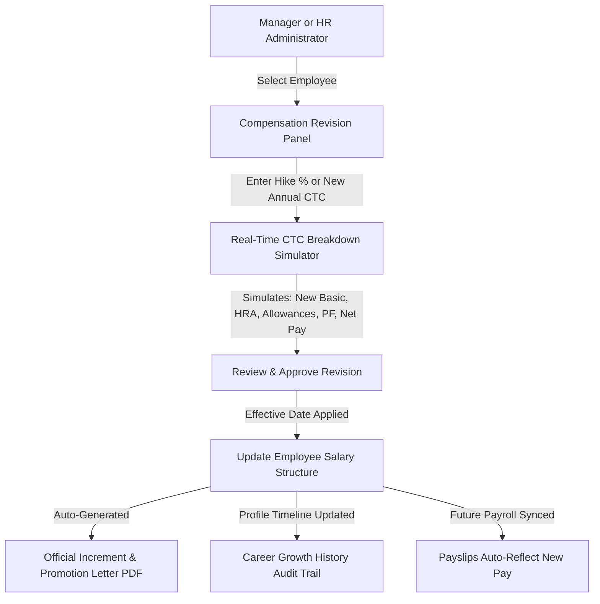
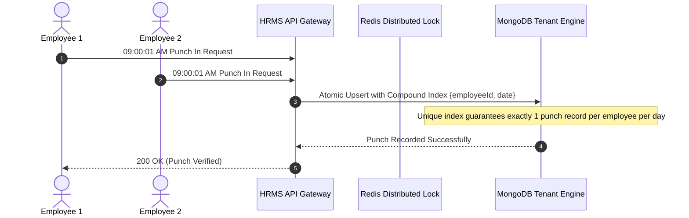
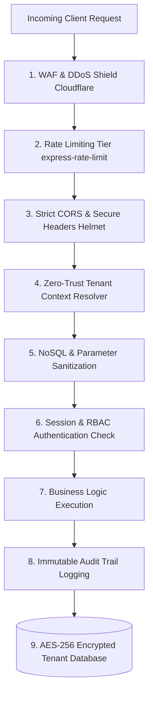

# HRMS Enterprise Next-Gen Suite — Comprehensive Specification & Manual
## AI Workspaces, Recruiter Interview Bot, Team Chat, Celebrations & Salary Hike Management

This comprehensive manual provides the architectural design, workflow diagrams, database schemas, and operational instructions for the enterprise suite additions to the **Multi-Tenant HRMS SaaS Platform**.

---

## 📋 Master Table of Contents

1. [AI Candidate Recruiting & Automated Interview Bot](#1-ai-candidate-recruiting--automated-interview-bot)
2. [AI Onboarding & Company Policy Assistant (RAG Engine)](#2-ai-onboarding--company-policy-assistant-rag-engine)
3. [Department-Dedicated AI Workspaces Suite](#3-department-dedicated-ai-workspaces-suite)
   - *Accounts & Finance Copilot*
   - *Operations & Logistics Copilot*
   - *HR & People Operations Copilot*
   - *Engineering & IT Copilot*
4. [Internal Team Chat & Collaboration (Teams/Slack Replacement)](#4-internal-team-chat--collaboration-teamsslack-replacement)
5. [Celebrations & Kudos Hub (Employee Recognition & Culture)](#5-celebrations--kudos-hub-employee-recognition--culture)
6. [Salary Hike, Compensation Revision & Promotion Management](#6-salary-hike-compensation-revision--promotion-management)
7. [Security, Multi-Tenancy & Access Control Architecture](#7-security-multi-tenancy--access-control-architecture)
8. [Database Schemas & Data Model Specifications](#8-database-schemas--data-model-specifications)
9. [API Endpoints & Routing Architecture](#9-api-endpoints--routing-architecture)
10. [Step-by-Step Implementation Roadmap](#10-step-by-step-implementation-roadmap)
11. [Enterprise Scalability Architecture](#11-enterprise-scalability-architecture)
12. [Concurrency & High-Throughput Engineering](#12-concurrency--high-throughput-engineering)
13. [Enterprise Security & Compliance Hardening](#13-enterprise-security--compliance-hardening)

---

## 1. AI Candidate Recruiting & Automated Interview Bot

### 1.1 Overview
The AI Recruiter enables HR teams to automatically screen, invite, and interview job applicants without manual phone-screening bottlenecks. It features a standalone, temporary **Candidate Exam Portal** where AI conducts structured interviews and evaluates candidate competence.

### 1.2 End-to-End Workflow Diagram



### 1.3 Key Functional Capabilities
1. **Short-Term Temporary Access Token:**
   - Single-use, time-limited token (configurable: 24–48 hours).
   - Candidate logs in using their email and token—they have zero access to company directories, internal chats, or payroll records.
   - Session auto-terminates once the assessment is submitted.
2. **Dynamic Role-Based Question Generation:**
   - Based on candidate's target designation (e.g. *Full Stack Developer*, *Accounts Manager*, *Sales Lead*) and extracted resume skills.
   - Questions cover:
     - **Core Technical Competencies:** Specific framework, language, or regulatory knowledge.
     - **Situational Scenarios:** e.g., *"How would you resolve a critical database outage during peak hours?"*
     - **Behavioral & Culture Fit:** Conflict resolution and teamwork questions.
3. **Timed Anti-Cheating Environment:**
   - Visual countdown timer per question (e.g. 90–120 seconds).
   - Copy-paste blocking and tab-switch detection logs.
4. **AI Scorecard & Evaluation Report:**
   - **Technical Mastery Score** (0–100)
   - **Clarity & Communication Score** (0–100)
   - **Critical Problem Solving Score** (0–100)
   - **Hiring Recommendation Badges:** 🟢 `STRONG_HIRE`, 🔵 `SHORTLIST`, 🟡 `HOLD`, 🔴 `REJECT`.
   - **Executive Summary:** Bullet-point strengths and areas of concern.
5. **1-Click Conversion to Active Employee:**
   - With one click on the HR dashboard, candidate contact info, target department, and initial salary populate into an active Employee record and trigger the onboarding checklist.


----------

## 2. AI Onboarding & Company Policy Assistant (RAG Engine)

### 2.1 Overview
A Retrieval-Augmented Generation (RAG) assistant that acts as a 24/7 personal guide for all employees—especially new hires during their first 30 days. It ingests company handbooks and SOPs to provide immediate, policy-accurate answers.

### 2.2 RAG Architecture Diagram



### 2.3 Key Functional Capabilities
1. **Document Ingestion Hub (`/hr/policies/upload`):**
   - HR uploads company policy documents (e.g., *Leave Policy 2026.pdf*, *Travel & Per-Diem Guidelines.docx*, *IT Security & Clean Desk SOP.pdf*, *Health Insurance FAQs.pdf*).
   - Documents are securely stored and tagged with the company's `tenantId`.
2. **Context-Aware Answers with Document Citations:**
   - Instead of generic answers, the AI cites exact policy sections:
     > *"Under Section 3.2 of the RSR Leave Policy, you are entitled to 1.5 days of Casual Leave per month after completing your 90-day probation period."*
3. **First-30-Days Onboarding Mode:**
   - For newly joined employees (`joiningDate < 30 days`), the bot proactively guides them:
     - Reminds them of pending onboarding checklist items (Bank details submission, IT setup).
     - Introduces reporting managers and department team members.
     - Explains shift timings, punch-in rules, and office geofence locations.

---

## 3. Department-Dedicated AI Workspaces Suite

Each operational department receives a dedicated AI copilot workspace embedded directly into their department dashboard (`/department/:department/ai-workspace`).

### 3.1 Accounts & Finance AI Workspace
* **Salary & CTC Breakdown Simulator:**
  - Input Annual CTC or monthly budget $\rightarrow$ AI auto-calculates the optimal tax-efficient salary structure:
    - Basic (40–50% of CTC)
    - HRA (40–50% of Basic)
    - Travel & Special Allowances
    - Employee & Employer PF (12%)
    - Gratuity (4.81%) & Professional Tax (PT)
    - Estimated Monthly Take-Home Pay
* **Expense Receipt Anomaly & Fraud Auditor:**
  - Automatically audits submitted expense receipts:
    - Flags duplicate bill numbers.
    - Flags claims outside standard travel dates or non-business days.
    - Flags meal/hotel claims exceeding company budget caps.
* **Payroll Anomaly Detector:**
  - Compares draft monthly payroll against the previous month:
    - *"5 employees have unexplained LOP deductions exceeding 3 days."*
    - *"Operations department overtime payouts increased by 28%."*

### 3.2 Operations & Logistics AI Workspace
* **GPS Trip Mileage vs. Claim Audit:**
  - Compares logged mobile GPS tracking routes against travel allowance expense claims to verify actual kilometers traveled.
* **Shift Roster & Burnout Optimizer:**
  - Evaluates past attendance, night shifts, and leave trends to recommend balanced weekly shift rosters that avoid staffing shortages.

### 3.3 HR & People Operations AI Workspace
* **Appraisal Review Copilot:**
  - Pulls an employee’s completed timesheet hours, quarterly project goals, attendance percentage, and peer kudos to draft unbiased, objective performance reviews.
* **Attrition Risk Predictor:**
  - Analyzes attendance regularizations, overtime spikes, and leave frequency to flag employees at risk of burnout or turnover.

### 3.4 Engineering & IT AI Workspace
* **Asset Allocation & Compliance Tracker:**
  - Tracks allocated laptops, monitors, software licenses, and access tokens.
* **Offboarding Security Revocation Audit:**
  - Validates that departing employees have surrendered physical hardware and had GitHub/AWS/Slack credentials revoked.

---

## 4. Internal Team Chat & Collaboration (Teams/Slack Replacement)

### 4.1 Overview
An integrated communication system built directly into the HRMS to replace external subscriptions like Microsoft Teams or Slack. It enables real-time messaging, file sharing, and workplace status awareness.

### 4.2 Core Collaboration Modules
1. **Direct Messages (1-on-1):**
   - Private, encrypted conversations between any two coworkers in the company.
2. **Department & Topic Channels:**
   - **`#general`**: Company-wide all-hands channel.
   - **Department Channels**: Auto-synced with employee departments (`#engineering`, `#hr`, `#accounts`, `#sales`, `#operations`).
   - **Custom Channels**: Private project or task channels created by managers.
3. **HRMS Context Cards Inside Chat:**
   - Share a payslip, ticket link, leave request, or project timesheet directly in the message feed with interactive action buttons.
4. **Attendance-Synced Workplace Status:**
   - 🟢 **Available:** Punched in and active on shift.
   - 🟡 **In Field / On Trip:** Active GPS trip in progress.
   - 🔴 **On Leave / Out of Office:** Approved leave recorded in the leave system.
   - ⚫ **Off Duty:** Punched out.

---

## 5. Celebrations & Kudos Hub (Employee Recognition & Culture)

### 5.1 Overview
A social recognition hub embedded in the main dashboard and notice board to boost company culture, improve retention, and recognize daily accomplishments.

### 5.2 Key Functional Capabilities
1. **Automated Life Event Banners:**
   - **🎂 Today's Birthdays:** Automated celebratory banner with interactive confetti when colleagues log in.
   - **🎖️ Work Anniversaries:** Milestone badges celebrating 1 Year, 3 Years, 5 Years of service.
   - **👋 Welcome New Joiners:** Introducing new employees to the team during their first week.
2. **Peer-to-Peer & Manager Kudos:**
   - Any employee can send public appreciation to a coworker.
   - **Predefined Badges:**
     - 🚀 *Innovator* (creative problem solver)
     - 🌟 *Team Player* (helping colleagues succeed)
     - 🏆 *Impact Player* (delivering critical business results)
     - 💡 *Problem Solver* (unblocking a difficult technical or client challenge)
3. **Interactive Social Wall:**
   - Colleagues can react (`❤️`, `👏`, `🎉`) and leave celebratory comments.
   - Kudos earned are displayed on the employee's public profile and factored into quarterly performance appraisals.

---

## 6. Salary Hike, Compensation Revision & Promotion Management

### 6.1 Overview
A structured compensation management system that tracks merit salary hikes, promotions, and market adjustments with full revision audit trails and auto-generated increment letters.

### 6.2 Compensation Workflow Diagram



### 6.3 Key Functional Capabilities
1. **Hike Calculator & Simulator:**
   - Enter either a percentage hike (e.g. `+15%`) or a target CTC (e.g. ₹6,50,000 to ₹7,50,000).
   - Instantly previews the impact on monthly payroll and employer cost.
2. **Promotion & Title Change:**
   - Update designations (e.g. *Junior Engineer* $\rightarrow$ *Senior Engineer*) and reporting managers simultaneously.
3. **Historical Audit Trail on Employee Profile:**
   - Every compensation revision is permanently logged:
     - *Effective Date*
     - *Previous CTC vs. New CTC*
     - *Percentage Increase*
     - *Reason (Annual Appraisal, Promotion, Market Correction)*
     - *Approved By*
4. **Branded Increment & Promotion Letter Generator:**
   - 1-click printable / downloadable PDF matching the payslip format:
     - Company header, logo, CIN, and address.
     - Formal appointment / promotion declaration.
     - **Annexure A:** Detailed monthly and annual breakdown table showing previous vs. revised figures.
     - Authorized HR signatory signature block.

---

## 7. Security, Multi-Tenancy & Access Control Architecture

### 7.1 Strict Multi-Tenant Isolation
* Every company's data (chat messages, candidate resumes, policy documents, salary revisions) is isolated in its dedicated tenant MongoDB database (`utils/tenantStore.js`).
* **Tenant Isolation Rule:** Queries for policy documents or chat channels strictly prepend the tenant connection, guaranteeing that Tenant A never accesses Tenant B’s data.

### 7.2 Role-Based Access Control (RBAC) Matrix

| Module | Employee | Department Manager | HR Manager | Super Admin | Candidate |
| :--- | :---: | :---: | :---: | :---: | :---: |
| **Candidate AI Exam Portal** | ❌ | ❌ | ❌ | ❌ | ✅ (Own Test) |
| **HR Candidate Scorecards** | ❌ | Read (Own Dept) | Full Access | Full Access | ❌ |
| **Policy Ingestion (Upload)** | ❌ | ❌ | Full Access | Full Access | ❌ |
| **Policy Chatbot (Ask Q&A)** | ✅ | ✅ | ✅ | ✅ | ❌ |
| **Accounts AI Workspace** | ❌ | ❌ | Full Access | Full Access | ❌ |
| **Team Chat (DMs & Channels)** | ✅ | ✅ | ✅ | Full Access | ❌ |
| **Kudos & Celebrations** | Read/Post | Read/Post | Full Admin | Full Admin | ❌ |
| **Salary Hike Approval** | ❌ | Propose (Own Dept) | Full Approval | Full Access | ❌ |
| **Increment Letter Download** | Read (Own) | Read (Team) | Full Access | Full Access | ❌ |

---

## 8. Database Schemas & Data Model Specifications

### 8.1 Candidate Model (`models/Candidate.js` — Extended)
```javascript
const candidateSchema = new mongoose.Schema({
  candidateName: { type: String, required: true },
  email: { type: String, required: true, lowercase: true },
  phone: String,
  targetRole: { type: String, required: true },
  department: { type: String, default: "GENERAL" },
  resumeText: String,
  resumeFileUrl: String,
  matchScore: { type: Number, default: 0 },
  
  // AI Interview Assessment
  interviewToken: { type: String, index: true },
  tokenExpiresAt: Date,
  interviewStatus: { 
    type: String, 
    enum: ["PENDING", "IN_PROGRESS", "COMPLETED", "EXPIRED"], 
    default: "PENDING" 
  },
  interviewStartedAt: Date,
  interviewCompletedAt: Date,
  interviewQuestions: [{
    questionId: String,
    category: String, // Technical, Situational, Behavioral
    questionText: String,
    expectedKeywords: [String],
    candidateAnswer: String,
    aiScore: Number, // 0 - 10
    aiFeedback: String
  }],
  aiAssessmentSummary: {
    technicalScore: Number,
    communicationScore: Number,
    problemSolvingScore: Number,
    overallScore: Number,
    recommendation: { type: String, enum: ["STRONG_HIRE", "SHORTLIST", "HOLD", "REJECT"] },
    summaryNotes: String
  },
  status: { type: String, enum: ["NEW", "INVITED", "INTERVIEWED", "HIRED", "REJECTED"], default: "NEW" },
  convertedToEmployeeId: { type: mongoose.Schema.Types.ObjectId, ref: "Employee" }
}, { timestamps: true });
```

### 8.2 Salary Revision Model (`models/SalaryRevision.js`)
```javascript
const salaryRevisionSchema = new mongoose.Schema({
  employeeId: { type: mongoose.Schema.Types.ObjectId, ref: "Employee", required: true },
  effectiveDate: { type: Date, required: true },
  revisionType: { 
    type: String, 
    enum: ["Annual Increment", "Promotion", "Market Correction", "Special Adjustment"], 
    default: "Annual Increment" 
  },
  previousDesignation: String,
  newDesignation: String,
  previousSalary: { type: Number, required: true }, // Monthly basic/gross
  newSalary: { type: Number, required: true },
  hikePercentage: { type: Number, required: true }, // e.g. 15.5%
  
  // Revised Component Breakdown
  breakdown: {
    basicSalary: Number,
    hra: Number,
    travelAllowance: Number,
    otherAllowances: Number,
    pf: Number,
    professionalTax: Number,
    netPay: Number
  },
  reason: String,
  status: { type: String, enum: ["PROPOSED", "APPROVED", "APPLIED"], default: "PROPOSED" },
  proposedBy: { type: mongoose.Schema.Types.ObjectId, ref: "Employee" },
  approvedBy: { type: mongoose.Schema.Types.ObjectId, ref: "Employee" },
  approvalDate: Date,
  letterGenerated: { type: Boolean, default: false }
}, { timestamps: true });
```

### 8.3 Kudos & Recognition Model (`models/Kudos.js`)
```javascript
const kudosSchema = new mongoose.Schema({
  senderId: { type: mongoose.Schema.Types.ObjectId, ref: "Employee", required: true },
  receiverId: { type: mongoose.Schema.Types.ObjectId, ref: "Employee", required: true },
  badge: { 
    type: String, 
    enum: ["INNOVATOR", "TEAM_PLAYER", "IMPACT_PLAYER", "PROBLEM_SOLVER", "LEADERSHIP"], 
    required: true 
  },
  message: { type: String, required: true, maxlength: 500 },
  department: String,
  reactions: [{
    employeeId: { type: mongoose.Schema.Types.ObjectId, ref: "Employee" },
    type: { type: String, enum: ["heart", "clap", "celebrate"] }
  }]
}, { timestamps: true });
```

### 8.4 Team Chat Message Model (`models/ChatMessage.js`)
```javascript
const chatMessageSchema = new mongoose.Schema({
  type: { type: String, enum: ["DIRECT", "CHANNEL"], required: true },
  channelName: String, // e.g. 'engineering', 'general' (if CHANNEL)
  senderId: { type: mongoose.Schema.Types.ObjectId, ref: "Employee", required: true },
  recipientId: { type: mongoose.Schema.Types.ObjectId, ref: "Employee" }, // (if DIRECT)
  messageText: { type: String, required: true },
  attachments: [{
    fileName: String,
    fileUrl: String,
    fileType: String
  }],
  reactions: [{
    employeeId: { type: mongoose.Schema.Types.ObjectId, ref: "Employee" },
    emoji: String
  }],
  readBy: [{ type: mongoose.Schema.Types.ObjectId, ref: "Employee" }]
}, { timestamps: true });
```

---

## 9. API Endpoints & Routing Architecture

### 9.1 AI Recruiting & Interview Routes (`routes/recruitment.js`)
* `GET /hr/recruitment` — HR Candidate Pipeline & Leaderboard
* `POST /hr/recruitment/screen` — AI Resume Screening parser
* `POST /hr/recruitment/:id/invite` — Generate 24h candidate invite link & send email
* `GET /interview/:token` — Candidate Exam Portal (Public, protected by unique token)
* `POST /interview/:token/submit` — Submit responses, trigger AI evaluation engine
* `GET /hr/recruitment/:id/report` — View AI interview scorecard & evaluation
* `POST /hr/recruitment/:id/convert` — 1-Click convert candidate to active Employee

### 9.2 Salary Revision & Hike Routes (`routes/salaryRevision.js`)
* `GET /hr/compensation` — Company Salary Revision Dashboard
* `POST /hr/compensation/simulate` — Real-time CTC breakdown calculator
* `POST /hr/compensation/propose` — Propose salary revision or promotion
* `POST /hr/compensation/:id/approve` — Approve revision & update employee master record
* `GET /hr/compensation/:id/letter` — Branded Increment / Promotion Letter (Print/PDF)
* `GET /employee/:id/compensation-history` — Employee growth timeline view

### 9.3 Celebrations & Kudos Routes (`routes/kudos.js`)
* `GET /kudos/feed` — Public celebrations & kudos feed
* `POST /kudos/send` — Award a badge & recognition post to a colleague
* `POST /kudos/:id/react` — React to a post (`❤️`, `👏`, `🎉`)
* `GET /kudos/birthdays-anniversaries` — Active birthday & work anniversary list

### 9.4 Team Chat Routes (`routes/chat.js`)
* `GET /chat` — Main Collaboration & Chat Hub
* `GET /chat/channel/:channelName` — Fetch channel messages
* `GET /chat/direct/:employeeId` — Fetch 1-on-1 direct message history
* `POST /chat/send` — Send message with optional file attachment
* `GET /chat/presence` — Fetch online/punch-in status of coworkers

---

## 10. Step-by-Step Implementation Roadmap

```
┌─────────────────────────────────────────────────────────────┐
│                   ENTERPRISE SUITE ROLLOUT                  │
└──────────────────────────────┬──────────────────────────────┘
                               │
       ┌───────────────────────┼───────────────────────┐
       ▼                       ▼                       ▼
┌──────────────┐        ┌──────────────┐        ┌──────────────┐
│   PHASE 1    │        │   PHASE 2    │        │   PHASE 3    │
│ Celebrations │        │ Salary Hike  │        │ Team Chat &  │
│  & Kudos Hub │        │ & Increment  │        │ Channels     │
│              │        │ Letters      │        │              │
└──────┬───────┘        └──────┬───────┘        └──────┬───────┘
       │                       │                       │
       └───────────────────────┼───────────────────────┘
                               ▼
                        ┌──────────────┐
                        │   PHASE 4    │
                        │ Recruiter AI │
                        │  & Workspace │
                        │ Tools        │
                        └──────────────┘
```

1. **Phase 1: Celebrations & Kudos Hub:**
   - Add automated birthday & anniversary banners to Employee Dashboard.
   - Deploy Kudos Model & Badge awarding interface.
2. **Phase 2: Salary Hike & Compensation Revision:**
   - Deploy `SalaryRevision` model and CTC simulator.
   - Implement Increment / Promotion Letter printable template.
   - Add career growth timeline to Employee Profile.
3. **Phase 3: Internal Team Chat:**
   - Build DM & Department Channels interface.
   - Integrate punch-in presence status.
4. **Phase 4: Candidate Interview Bot & Department AI Workspaces:**
   - Build temporary candidate interview portal (`/interview/:token`).
   - Implement Accounts salary calculator & expense anomaly audit tools.
5. **Phase 5: Employee 360° Monthly Review Dossier (1-on-1 Performance PDF):**
   - Aggregate monthly Attendance compliance, Leaves taken, Business Trips, OKR goals progress, Manager & Self Appraisal ratings, and Expenses.
   - Branded A4 print-ready layout (`/employee/:id/monthly-dossier?month=YYYY-MM`) with one-click export for manager-employee 1-on-1 appraisal meetings.


---

## 11. Enterprise Scalability Architecture

To support **100+ tenant companies and 50,000+ concurrent employees**, the HRMS architecture is designed to scale horizontally across stateless app servers while keeping resource utilization predictable.

```
                         ┌───────────────────────────────────┐
                         │   AWS Route53 / Cloudflare DNS    │
                         └─────────────────┬─────────────────┘
                                           │
                                           ▼
                         ┌───────────────────────────────────┐
                         │   AWS Application Load Balancer   │
                         │      (HTTPS / TLS 1.3 Termination) │
                         └─────────────────┬─────────────────┘
                                           │
                ┌──────────────────────────┼──────────────────────────┐
                ▼                          ▼                          ▼
      ┌──────────────────┐       ┌──────────────────┐       ┌──────────────────┐
      │   Node Pod 1     │       │   Node Pod 2     │       │   Node Pod N     │
      │   (Stateless)    │       │   (Stateless)    │       │   (Stateless)    │
      └─────────┬────────┘       └─────────┬────────┘       └─────────┬────────┘
                │                          │                          │
                └──────────────────────────┼──────────────────────────┘
                                           │
                     ┌─────────────────────┴─────────────────────┐
                     ▼                                           ▼
         ┌───────────────────────┐                   ┌───────────────────────┐
         │     Redis Cluster     │                   │  MongoDB Atlas Cluster│
         │ (Sessions, PubSub,    │                   │ (Dedicated Multi-DB   │
         │  BullMQ Task Queues)  │                   │  Namespace per Tenant)│
         └───────────────────────┘                   └───────────────────────┘
```

### 11.1 Stateless Application Tier & Autoscaling
* **Horizontal Scaling (AWS ECS / Kubernetes / PM2 Cluster):**
  - Application instances run in stateless containers behind an Application Load Balancer (ALB).
  - CPU & Memory threshold autoscaling: triggers scale-out when average CPU exceeds 70% or active HTTP connection pools spike.
* **Externalized Session Storage:**
  - Standard sessions are externalized into a high-throughput **Redis cluster** using `connect-redis` instead of writing session cookies to the local server memory. If Pod 1 restarts or crashes, the user’s session is immediately serviced by Pod 2 without logging out.

### 11.2 Asynchronous Background Queue Worker (BullMQ + Redis)
CPU-heavy and I/O-intensive workloads must **never block the Express event loop**. They are dispatched as background jobs via BullMQ:
1. **AI Resume Screening & Embeddings Generation:** Processing multiple 10MB PDF resumes runs in background worker threads.
2. **Bulk Payslip PDF Generation:** Compiling 1,000+ monthly payslips and generating downloadable PDFs is queued with progress telemetry reported back to HR.
3. **Mass Email & Notification Dispatch:** Automated email notifications (Payslips, Leave Approvals, Candidate Invites) are rate-limited and sent asynchronously via Resend/SendGrid worker queues.

### 11.3 Multi-Tenant Database Connection Pool Management
* **The Connection Exhaustion Problem:** In a dynamic multi-tenant architecture with separate databases, blindly opening unbounded connections (`mongoose.createConnection()`) for every tenant can quickly exhaust MongoDB’s connection limits.
* **The Architectural Solution:**
  - **Connection Pool Capping:** Configure `maxPoolSize: 20` and `minPoolSize: 2` per tenant connection.
  - **LRU Connection Cache with Idle Eviction:** Active tenant connections are stored in an LRU (Least Recently Used) cache in `utils/tenantManager.js`. Tenant connections that have been inactive for more than 15 minutes are gracefully closed and purged from memory, keeping active connections lean.

---

## 12. Concurrency & High-Throughput Engineering

High-concurrency scenarios in HR systems occur during predictable peak bursts (e.g., 9:00 AM shift punch-ins, month-end payroll execution). The system enforces strict concurrency controls to prevent race conditions and double-entry discrepancies.



### 12.1 The 9:00 AM Attendance Surge & Zero-Duplicate Guarantees
* **The Risk:** Thousands of employees clock in within a 15-minute window. Rapid double-tapping on mobile or network retries can create duplicate attendance records.
* **The Defense:**
  1. **Compound Unique Index:** `AttendanceSchema.index({ employeeId: 1, date: 1 }, { unique: true })`.
  2. **Atomic Idempotent Upsert:** Rather than checking `findOne()` followed by `create()`, the API executes a single atomic operation:
     ```javascript
     await Attendance.findOneAndUpdate(
       { employeeId: req.session.employeeId, date: todayDate },
       {
         $setOnInsert: {
           employeeId: req.session.employeeId,
           date: todayDate,
           punchIn: new Date(),
           punchInLocation: { lat, lng, address }
         },
         $set: { lastActiveAt: new Date() }
       },
       { upsert: true, new: true, setDefaultsOnInsert: true }
     );
     ```
     Even if 5 duplicate requests arrive in the same millisecond, exactly **one** attendance record is created.

### 12.2 Atomic Leave Deduction (Preventing Negative Balances)
* **The Risk:** An employee rapidly clicks "Apply" on two tabs for the same remaining 1-day leave balance. Concurrent requests could both read `leaveBalance = 1` and deduct to `-1`.
* **The Defense:** Atomic conditional decrement in MongoDB:
  ```javascript
  const result = await Employee.findOneAndUpdate(
    { 
      _id: employeeId, 
      leaveBalance: { $gte: requestedDays } // Concurrency check
    },
    { 
      $inc: { leaveBalance: -requestedDays } 
    },
    { new: true }
  );

  if (!result) {
    throw new Error("Insufficient leave balance or concurrent transaction in progress.");
  }
  ```

### 12.3 Distributed Locking for Monthly Bulk Payroll Runs
* **The Risk:** Two HR managers simultaneously click *"Generate Bulk Payslips for October"*, generating duplicate payslips and doubling salary deductions.
* **The Defense:** Distributed Redis Lease Lock (`Redlock`):
  - When payroll starts, a distributed lock is acquired: `lock:payroll:<tenantId>:<year>:<month>` with a 300-second TTL.
  - If a second process attempts to run payroll for the same month, it is rejected immediately with HTTP 409 Conflict: *"Payroll generation currently in progress by another administrator."*

### 12.4 High-Volume Real-Time Chat Concurrency
* **WebSocket Horizontal Scaling:**
  - WebSockets (Socket.io) are decoupled across app servers using the **`@socket.io/redis-adapter`**.
  - When Employee A (connected to Pod 1) sends a message to `#engineering`, the message publishes to Redis Pub/Sub, broadcasting instantaneously to Employee B (connected to Pod 3).

---

## 13. Enterprise Security & Compliance Hardening

To satisfy enterprise procurement standards and privacy regulations (SOC 2, ISO 27001, GDPR, and India DPDP), the system implements defense-in-depth across every architectural boundary.



### 13.1 Zero-Trust Multi-Tenant Database Boundary Enforcement
* **Context Resolution Hardening:** The dynamic tenant connection is resolved via `AsyncLocalStorage` (`utils/tenantStore.js`).
* **Tenant Cross-Contamination Guard:** Every query executed inside the tenant connection proxy is cryptographically locked to that company’s database. Even if a malicious request injects a different company’s `employeeId`, the query returns `404 Not Found` because the record does not exist in the isolated tenant database.

### 13.2 NoSQL Injection & Request Parameter Sanitization
* **The Risk:** Unsanitized JSON payloads containing operator objects (e.g. `{"username": {"$gt": ""}}`) bypassing credential lookups.
* **The Defense:**
  - Automated parameter sanitization stripping `$` and `.` prefixes from user input:
    ```javascript
    const mongoSanitize = require('express-mongo-sanitize');
    app.use(mongoSanitize({ replaceWith: '_' }));
    ```
  - Explicit string casting on login lookups (`String(req.body.username).trim()`).

### 13.3 Multi-Tier Rate Limiting Matrix
* **Public / Landing Routes:** 100 requests per minute per IP.
* **Authentication & Login Routes:** Maximum 5 failed attempts per 15-minute window (`authLimiter`).
* **AI Invocation Endpoints (Resume Screener, Interview Bot, RAG Q&A):** Maximum 20 AI prompts per minute per tenant to protect against token exhaustion and denial-of-wallet attacks.

### 13.4 Comprehensive Immutable Audit Logging (`AuditLog`)
Every administrative action (salary revisions, employee terminations, document downloads, policy updates) writes an immutable record to the tenant’s audit log:

```javascript
const auditLogSchema = new mongoose.Schema({
  timestamp: { type: Date, default: Date.now, index: true },
  actorId: { type: mongoose.Schema.Types.ObjectId, required: true },
  actorName: String,
  actorRole: { type: String, enum: ["HR", "MANAGER", "SUPERADMIN"], required: true },
  ipAddress: String,
  userAgent: String,
  action: { 
    type: String, 
    enum: ["EMPLOYEE_DELETE", "SALARY_HIKE_APPROVED", "POLICY_UPDATED", "DOCUMENT_DOWNLOADED", "ROLE_CHANGED"], 
    required: true 
  },
  targetResource: String, // e.g. "Employee:65f3a1..."
  changes: {
    previousState: mongoose.Schema.Types.Mixed,
    newState: mongoose.Schema.Types.Mixed
  }
});
```

### 13.5 Enterprise Compliance Readiness Checklist

| Standard | Requirement | Implementation in HRMS Platform |
| :--- | :--- | :--- |
| **SOC 2 Type II** | Access Control & Least Privilege | Strict RBAC matrix; managers only see their department; employees only see their records. |
| **SOC 2 Type II** | Encryption in Transit & At Rest | TLS 1.3 on all endpoints; MongoDB Atlas AES-256 storage volume encryption enabled. |
| **ISO 27001** | Secrets & Credential Management | Zero hardcoded default passwords; production secrets injected via AWS Secrets Manager. |
| **GDPR / DPDP** | Right to be Forgotten | Automated permanent deletion pipeline erases all PII, documents, and biometric records. |
| **GDPR** | Data Minimization & Isolation | Strict multi-tenant database isolation; tenant databases never shared. |

---
*Manual Version: 2.0 • Enterprise Multi-Tenant HRMS Suite*

